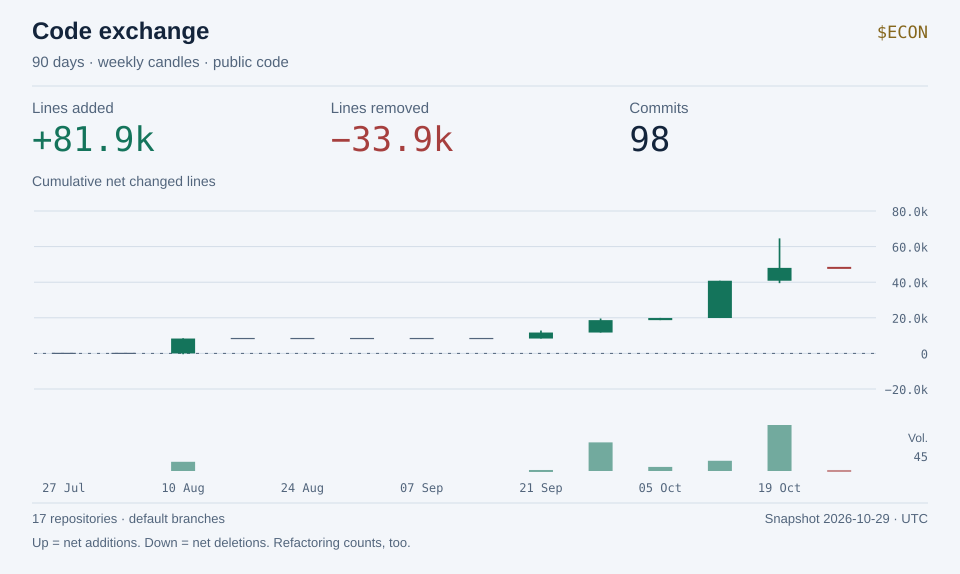
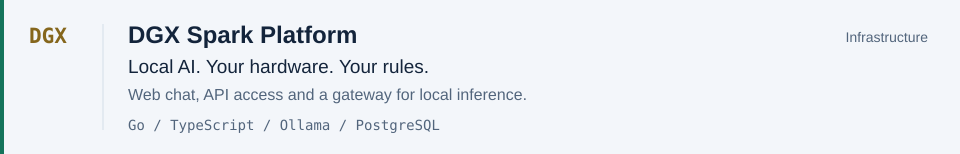
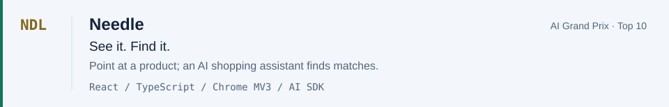
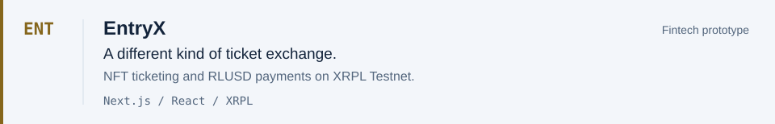
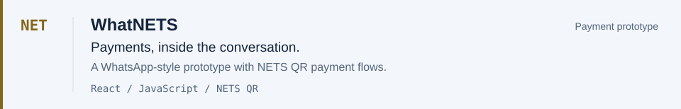
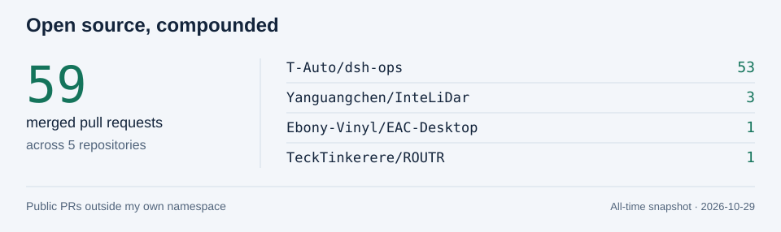

# Economist

**Shen Haoming · Capital meets code.**

I build full-stack products, AI workflows, and the infrastructure behind them. My interests sit where intelligent systems meet real-world decisions: how we work, what we buy, and how money moves.

[Portfolio](https://www.shen-haoming.com/) &nbsp; / &nbsp; [LinkedIn](https://www.linkedin.com/in/shen-haoming/) &nbsp; / &nbsp; [Repositories](https://github.com/Haoming9527?tab=repositories) &nbsp; / &nbsp; [Merged contributions](https://github.com/search?q=is%3Apr+is%3Apublic+author%3AHaoming9527+is%3Amerged+-user%3AHaoming9527&type=pullrequests)

<picture>
  <source media="(prefers-color-scheme: dark) and (max-width: 600px)" srcset="assets/activity-dark-mobile.svg" />
  <source media="(max-width: 600px)" srcset="assets/activity-light-mobile.svg" />
  <source media="(prefers-color-scheme: dark)" srcset="assets/activity-dark.svg" />
  
</picture>

How to read the tape

Each candle is a week of authored commits in the public repositories listed in [profile.json](profile.json). Adding lines moves the running total up; removing lines moves it down. A green candle closes above its opening total, and a red candle closes below it. The bars underneath show commit counts.

The chart starts at zero for each rolling 90-day window. Wicks follow a consistent convention: additions first, then deletions within each commit. They describe that calculation, not a real intracommit timeline. Empty weeks are flat marks. Merge commits and duplicate SHAs are excluded; only selected default branches are covered. This is a picture of change, not productivity—good refactoring can be a red candle.

[Exact snapshot](data/activity.json) · [Methodology and refresh setup](docs/activity.md)

### The thesis

**Long on useful intelligence.** Models become interesting when they can do work: connected to tools, data, and an interface people understand. My current focus is AI engineering and agentic systems, with a full-stack foundation underneath.

**Build the whole system.** From a browser extension to a local inference gateway, I like working across the interface, API, and infrastructure—not stopping at the demo.

Currently working in **Core Engineering R&D AI at OCBC** and studying **Information Technology at Singapore Polytechnic**. More on my [experience](https://www.shen-haoming.com/experience).

### Selected positions

<a href="https://github.com/Haoming9527/DGX-Spark-Platform">
  <picture>
    <source media="(prefers-color-scheme: dark) and (max-width: 600px)" srcset="assets/project-dgx-dark-mobile.svg" />
    <source media="(max-width: 600px)" srcset="assets/project-dgx-light-mobile.svg" />
    <source media="(prefers-color-scheme: dark)" srcset="assets/project-dgx-dark.svg" />
    
  </picture>
</a>

<a href="https://github.com/Haoming9527/Needle">
  <picture>
    <source media="(prefers-color-scheme: dark) and (max-width: 600px)" srcset="assets/project-needle-dark-mobile.svg" />
    <source media="(max-width: 600px)" srcset="assets/project-needle-light-mobile.svg" />
    <source media="(prefers-color-scheme: dark)" srcset="assets/project-needle-dark.svg" />
    
  </picture>
</a>

<a href="https://github.com/Haoming9527/EntryX">
  <picture>
    <source media="(prefers-color-scheme: dark) and (max-width: 600px)" srcset="assets/project-entryx-dark-mobile.svg" />
    <source media="(max-width: 600px)" srcset="assets/project-entryx-light-mobile.svg" />
    <source media="(prefers-color-scheme: dark)" srcset="assets/project-entryx-dark.svg" />
    
  </picture>
</a>

<a href="https://github.com/Haoming9527/WhatNETS">
  <picture>
    <source media="(prefers-color-scheme: dark) and (max-width: 600px)" srcset="assets/project-whatnets-dark-mobile.svg" />
    <source media="(max-width: 600px)" srcset="assets/project-whatnets-light-mobile.svg" />
    <source media="(prefers-color-scheme: dark)" srcset="assets/project-whatnets-dark.svg" />
    
  </picture>
</a>

### Stack

| Where I work | What I reach for |
| :--- | :--- |
| Interfaces | TypeScript · React · Next.js · Tailwind CSS |
| Systems & data | Go · Node.js · PostgreSQL · SQLite · Docker |
| AI workflows | Ollama · OpenAI · Gemini · AI SDK · MCP |
| Experiments | Chrome extensions · XRPL · Spatial interfaces |

### Beyond my own repositories

<a href="https://github.com/search?q=is%3Apr+is%3Apublic+author%3AHaoming9527+is%3Amerged+-user%3AHaoming9527&type=pullrequests">
  <picture>
    <source media="(prefers-color-scheme: dark) and (max-width: 600px)" srcset="assets/open-source-dark-mobile.svg" />
    <source media="(max-width: 600px)" srcset="assets/open-source-light-mobile.svg" />
    <source media="(prefers-color-scheme: dark)" srcset="assets/open-source-dark.svg" />
    
  </picture>
</a>

- **[dsh-ops](https://github.com/T-Auto/dsh-ops/pulls?q=is%3Apr+author%3AHaoming9527+is%3Amerged):** TypeScript migration, Rust kernel work, bounded document readers, and cross-platform reliability.
- **[InteLiDar](https://github.com/Yanguangchen/InteLiDar):** turning scanned rooms into interactive 3D environments for spatial AI.
- **[EAC-Desktop](https://github.com/Ebony-Vinyl/EAC-Desktop/pull/465):** portable-plugin compatibility and shell integration.

### Track record

| Result | Where |
| :--- | :--- |
| **Top 10** | [AI Grand Prix Singapore](https://github.com/Haoming9527/Needle#readme) · Needle |
| **1st runner-up** | [SG × Sarawak Friendship AI Business Design Hackathon 2026](https://sg.linkedin.com/company/saiyanbuilders) · Team SHB |
| **2nd runner-up** | [SEED Code League 2024](https://www.linkedin.com/in/shen-haoming/) |
| **Semifinalist** | [Singapore Undergraduate Policy Competition 2024](https://www.linkedin.com/in/shen-haoming/) |

Activity and contribution boards refresh daily. [Sources](docs/sources.md) · [How this profile works](docs/activity.md)
