<!-- Generated by scripts/render_profile.py from profile.json and data/activity.json. Edit those, not this file. -->

 <a href="data/activity.json" title="Snapshot data"><picture><source media="(prefers-color-scheme: dark) and (max-width: 600px)" srcset="assets/gen/tape-dark-m.svg"><source media="(max-width: 600px)" srcset="assets/gen/tape-light-m.svg"><source media="(prefers-color-scheme: dark)" srcset="assets/gen/tape-dark.svg"></picture></a>

<a href="https://www.shen-haoming.com/" title="Open portfolio"><picture><source media="(prefers-color-scheme: dark) and (max-width: 600px)" srcset="assets/gen/identity-dark-m.svg"><source media="(max-width: 600px)" srcset="assets/gen/identity-light-m.svg"><source media="(prefers-color-scheme: dark)" srcset="assets/gen/identity-dark.svg"></picture></a>

<a href="https://github.com/Haoming9527?tab=repositories&amp;sort=stargazers" title="4,826 stars across 21 public repositories: mine plus external repos with my merged PRs; +805 in the last 7 days"><picture><source media="(prefers-color-scheme: dark) and (max-width: 600px)" srcset="assets/gen/index-stars-dark-m.svg"><source media="(max-width: 600px)" srcset="assets/gen/index-stars-light-m.svg"><source media="(prefers-color-scheme: dark)" srcset="assets/gen/index-stars-dark.svg"></picture></a><a href="https://github.com/search?type=commits&amp;q=author%3AHaoming9527+user%3AHaoming9527+-repo%3AHaoming9527%2FHaoming9527+committer-date%3A2026-08-02..2026-10-30" title="98 authored, non-merge commits in 90 days; +26 in the last 7 days"><picture><source media="(prefers-color-scheme: dark) and (max-width: 600px)" srcset="assets/gen/index-commits-dark-m.svg"><source media="(max-width: 600px)" srcset="assets/gen/index-commits-light-m.svg"><source media="(prefers-color-scheme: dark)" srcset="assets/gen/index-commits-dark.svg"></picture></a><a href="https://github.com/search?q=is%3Apr+author%3AHaoming9527+is%3Amerged+-user%3AHaoming9527+is%3Apublic+-repo%3AEbony-Vinyl%2FEAC-Desktop&amp;type=pullrequests" title="58 merged public pull requests to repositories I don&#x27;t own; +18 in the last 7 days"><picture><source media="(prefers-color-scheme: dark) and (max-width: 600px)" srcset="assets/gen/index-prs-dark-m.svg"><source media="(max-width: 600px)" srcset="assets/gen/index-prs-light-m.svg"><source media="(prefers-color-scheme: dark)" srcset="assets/gen/index-prs-dark.svg"></picture></a>

<a href="data/activity.json"><picture><source media="(prefers-color-scheme: dark) and (max-width: 600px)" srcset="assets/gen/chart-header-dark-m.svg"><source media="(max-width: 600px)" srcset="assets/gen/chart-header-light-m.svg"><source media="(prefers-color-scheme: dark)" srcset="assets/gen/chart-header-dark.svg"></picture></a> <a href="https://github.com/search?type=commits&amp;q=author%3AHaoming9527+user%3AHaoming9527+-repo%3AHaoming9527%2FHaoming9527+committer-date%3A2026-07-27..2026-08-02" title="Week of 27 Jul 2026: no commits; index flat at 0"><picture><source media="(prefers-color-scheme: dark) and (max-width: 600px)" srcset="assets/gen/chart-week-00-dark-m.svg"><source media="(max-width: 600px)" srcset="assets/gen/chart-week-00-light-m.svg"><source media="(prefers-color-scheme: dark)" srcset="assets/gen/chart-week-00-dark.svg"></picture></a><a href="https://github.com/search?type=commits&amp;q=author%3AHaoming9527+user%3AHaoming9527+-repo%3AHaoming9527%2FHaoming9527+committer-date%3A2026-08-03..2026-08-09" title="Week of 03 Aug 2026: no commits; index flat at 0"><picture><source media="(prefers-color-scheme: dark) and (max-width: 600px)" srcset="assets/gen/chart-week-01-dark-m.svg"><source media="(max-width: 600px)" srcset="assets/gen/chart-week-01-light-m.svg"><source media="(prefers-color-scheme: dark)" srcset="assets/gen/chart-week-01-dark.svg"></picture></a><a href="https://github.com/search?type=commits&amp;q=author%3AHaoming9527+user%3AHaoming9527+-repo%3AHaoming9527%2FHaoming9527+committer-date%3A2026-08-10..2026-08-16" title="Week of 10 Aug 2026: 9 commits, +11,388 / −3,037 lines, close 8,351"><picture><source media="(prefers-color-scheme: dark) and (max-width: 600px)" srcset="assets/gen/chart-week-02-dark-m.svg"><source media="(max-width: 600px)" srcset="assets/gen/chart-week-02-light-m.svg"><source media="(prefers-color-scheme: dark)" srcset="assets/gen/chart-week-02-dark.svg"></picture></a><a href="https://github.com/search?type=commits&amp;q=author%3AHaoming9527+user%3AHaoming9527+-repo%3AHaoming9527%2FHaoming9527+committer-date%3A2026-08-17..2026-08-23" title="Week of 17 Aug 2026: no commits; index flat at 8,351"><picture><source media="(prefers-color-scheme: dark) and (max-width: 600px)" srcset="assets/gen/chart-week-03-dark-m.svg"><source media="(max-width: 600px)" srcset="assets/gen/chart-week-03-light-m.svg"><source media="(prefers-color-scheme: dark)" srcset="assets/gen/chart-week-03-dark.svg"></picture></a><a href="https://github.com/search?type=commits&amp;q=author%3AHaoming9527+user%3AHaoming9527+-repo%3AHaoming9527%2FHaoming9527+committer-date%3A2026-08-24..2026-08-30" title="Week of 24 Aug 2026: no commits; index flat at 8,351"><picture><source media="(prefers-color-scheme: dark) and (max-width: 600px)" srcset="assets/gen/chart-week-04-dark-m.svg"><source media="(max-width: 600px)" srcset="assets/gen/chart-week-04-light-m.svg"><source media="(prefers-color-scheme: dark)" srcset="assets/gen/chart-week-04-dark.svg"></picture></a><a href="https://github.com/search?type=commits&amp;q=author%3AHaoming9527+user%3AHaoming9527+-repo%3AHaoming9527%2FHaoming9527+committer-date%3A2026-08-31..2026-09-06" title="Week of 31 Aug 2026: no commits; index flat at 8,351"><picture><source media="(prefers-color-scheme: dark) and (max-width: 600px)" srcset="assets/gen/chart-week-05-dark-m.svg"><source media="(max-width: 600px)" srcset="assets/gen/chart-week-05-light-m.svg"><source media="(prefers-color-scheme: dark)" srcset="assets/gen/chart-week-05-dark.svg"></picture></a><a href="https://github.com/search?type=commits&amp;q=author%3AHaoming9527+user%3AHaoming9527+-repo%3AHaoming9527%2FHaoming9527+committer-date%3A2026-09-07..2026-09-13" title="Week of 07 Sep 2026: no commits; index flat at 8,351"><picture><source media="(prefers-color-scheme: dark) and (max-width: 600px)" srcset="assets/gen/chart-week-06-dark-m.svg"><source media="(max-width: 600px)" srcset="assets/gen/chart-week-06-light-m.svg"><source media="(prefers-color-scheme: dark)" srcset="assets/gen/chart-week-06-dark.svg"></picture></a><a href="https://github.com/search?type=commits&amp;q=author%3AHaoming9527+user%3AHaoming9527+-repo%3AHaoming9527%2FHaoming9527+committer-date%3A2026-09-14..2026-09-20" title="Week of 14 Sep 2026: no commits; index flat at 8,351"><picture><source media="(prefers-color-scheme: dark) and (max-width: 600px)" srcset="assets/gen/chart-week-07-dark-m.svg"><source media="(max-width: 600px)" srcset="assets/gen/chart-week-07-light-m.svg"><source media="(prefers-color-scheme: dark)" srcset="assets/gen/chart-week-07-dark.svg"></picture></a><a href="https://github.com/search?type=commits&amp;q=author%3AHaoming9527+user%3AHaoming9527+-repo%3AHaoming9527%2FHaoming9527+committer-date%3A2026-09-21..2026-09-27" title="Week of 21 Sep 2026: 1 commit, +4,494 / −1,123 lines, close 11,722"><picture><source media="(prefers-color-scheme: dark) and (max-width: 600px)" srcset="assets/gen/chart-week-08-dark-m.svg"><source media="(max-width: 600px)" srcset="assets/gen/chart-week-08-light-m.svg"><source media="(prefers-color-scheme: dark)" srcset="assets/gen/chart-week-08-dark.svg"></picture></a><a href="https://github.com/search?type=commits&amp;q=author%3AHaoming9527+user%3AHaoming9527+-repo%3AHaoming9527%2FHaoming9527+committer-date%3A2026-09-28..2026-10-04" title="Week of 28 Sep 2026: 28 commits, +9,968 / −3,002 lines, close 18,688"><picture><source media="(prefers-color-scheme: dark) and (max-width: 600px)" srcset="assets/gen/chart-week-09-dark-m.svg"><source media="(max-width: 600px)" srcset="assets/gen/chart-week-09-light-m.svg"><source media="(prefers-color-scheme: dark)" srcset="assets/gen/chart-week-09-dark.svg"></picture></a><a href="https://github.com/search?type=commits&amp;q=author%3AHaoming9527+user%3AHaoming9527+-repo%3AHaoming9527%2FHaoming9527+committer-date%3A2026-10-05..2026-10-11" title="Week of 05 Oct 2026: 4 commits, +1,290 / −102 lines, close 19,876"><picture><source media="(prefers-color-scheme: dark) and (max-width: 600px)" srcset="assets/gen/chart-week-10-dark-m.svg"><source media="(max-width: 600px)" srcset="assets/gen/chart-week-10-light-m.svg"><source media="(prefers-color-scheme: dark)" srcset="assets/gen/chart-week-10-dark.svg"></picture></a><a href="https://github.com/search?type=commits&amp;q=author%3AHaoming9527+user%3AHaoming9527+-repo%3AHaoming9527%2FHaoming9527+committer-date%3A2026-10-12..2026-10-18" title="Week of 12 Oct 2026: 10 commits, +25,446 / −4,503 lines, close 40,819"><picture><source media="(prefers-color-scheme: dark) and (max-width: 600px)" srcset="assets/gen/chart-week-11-dark-m.svg"><source media="(max-width: 600px)" srcset="assets/gen/chart-week-11-light-m.svg"><source media="(prefers-color-scheme: dark)" srcset="assets/gen/chart-week-11-dark.svg"></picture></a><a href="https://github.com/search?type=commits&amp;q=author%3AHaoming9527+user%3AHaoming9527+-repo%3AHaoming9527%2FHaoming9527+committer-date%3A2026-10-19..2026-10-25" title="Week of 19 Oct 2026: 45 commits, +29,325 / −22,096 lines, close 48,048"><picture><source media="(prefers-color-scheme: dark) and (max-width: 600px)" srcset="assets/gen/chart-week-12-dark-m.svg"><source media="(max-width: 600px)" srcset="assets/gen/chart-week-12-light-m.svg"><source media="(prefers-color-scheme: dark)" srcset="assets/gen/chart-week-12-dark.svg"></picture></a><a href="https://github.com/search?type=commits&amp;q=author%3AHaoming9527+user%3AHaoming9527+-repo%3AHaoming9527%2FHaoming9527+committer-date%3A2026-10-26..2026-11-01" title="Week of 26 Oct 2026: 1 commit, +36 / −50 lines, close 48,034"><picture><source media="(prefers-color-scheme: dark) and (max-width: 600px)" srcset="assets/gen/chart-week-13-dark-m.svg"><source media="(max-width: 600px)" srcset="assets/gen/chart-week-13-light-m.svg"><source media="(prefers-color-scheme: dark)" srcset="assets/gen/chart-week-13-dark.svg"></picture></a><a href="data/activity.json" title="Snapshot data and methodology"><picture><source media="(prefers-color-scheme: dark) and (max-width: 600px)" srcset="assets/gen/chart-axis-dark-m.svg"><source media="(max-width: 600px)" srcset="assets/gen/chart-axis-light-m.svg"><source media="(prefers-color-scheme: dark)" srcset="assets/gen/chart-axis-dark.svg"></picture></a>

<a href="https://github.com/Haoming9527?tab=repositories" title="All repositories"><picture><source media="(prefers-color-scheme: dark) and (max-width: 600px)" srcset="assets/gen/section-watchlist-dark-m.svg"><source media="(max-width: 600px)" srcset="assets/gen/section-watchlist-light-m.svg"><source media="(prefers-color-scheme: dark)" srcset="assets/gen/section-watchlist-dark.svg"></picture></a> <a href="https://github.com/Haoming9527/Needle" title="Needle (NDL): 25 authored commits since Oct 2026; +7,059 net lines in the last 90 days"><picture><source media="(prefers-color-scheme: dark) and (max-width: 600px)" srcset="assets/gen/project-0-dark-m.svg"><source media="(max-width: 600px)" srcset="assets/gen/project-0-light-m.svg"><source media="(prefers-color-scheme: dark)" srcset="assets/gen/project-0-dark.svg"></picture></a> <a href="https://github.com/Haoming9527/EntryX" title="EntryX (ENTX): 8 authored commits since Jan 2026; 0 net lines in the last 90 days"><picture><source media="(prefers-color-scheme: dark) and (max-width: 600px)" srcset="assets/gen/project-1-dark-m.svg"><source media="(max-width: 600px)" srcset="assets/gen/project-1-light-m.svg"><source media="(prefers-color-scheme: dark)" srcset="assets/gen/project-1-dark.svg"></picture></a> <a href="https://github.com/Haoming9527/WhatNETS" title="WhatNETS (WNTS): 6 authored commits since Aug 2025; 0 net lines in the last 90 days"><picture><source media="(prefers-color-scheme: dark) and (max-width: 600px)" srcset="assets/gen/project-2-dark-m.svg"><source media="(max-width: 600px)" srcset="assets/gen/project-2-light-m.svg"><source media="(prefers-color-scheme: dark)" srcset="assets/gen/project-2-dark.svg"></picture></a>

<a href="https://github.com/Haoming9527?tab=repositories" title="All repositories"><picture><source media="(prefers-color-scheme: dark) and (max-width: 600px)" srcset="assets/gen/section-languages-dark-m.svg"><source media="(max-width: 600px)" srcset="assets/gen/section-languages-light-m.svg"><source media="(prefers-color-scheme: dark)" srcset="assets/gen/section-languages-dark.svg"></picture></a> <picture><source media="(prefers-color-scheme: dark) and (max-width: 600px)" srcset="assets/gen/lang-0-dark-m.svg"><source media="(max-width: 600px)" srcset="assets/gen/lang-0-light-m.svg"><source media="(prefers-color-scheme: dark)" srcset="assets/gen/lang-0-dark.svg"></picture> <picture><source media="(prefers-color-scheme: dark) and (max-width: 600px)" srcset="assets/gen/lang-1-dark-m.svg"><source media="(max-width: 600px)" srcset="assets/gen/lang-1-light-m.svg"><source media="(prefers-color-scheme: dark)" srcset="assets/gen/lang-1-dark.svg"></picture> <picture><source media="(prefers-color-scheme: dark) and (max-width: 600px)" srcset="assets/gen/lang-2-dark-m.svg"><source media="(max-width: 600px)" srcset="assets/gen/lang-2-light-m.svg"><source media="(prefers-color-scheme: dark)" srcset="assets/gen/lang-2-dark.svg"></picture> <picture><source media="(prefers-color-scheme: dark) and (max-width: 600px)" srcset="assets/gen/lang-3-dark-m.svg"><source media="(max-width: 600px)" srcset="assets/gen/lang-3-light-m.svg"><source media="(prefers-color-scheme: dark)" srcset="assets/gen/lang-3-dark.svg"></picture> <picture><source media="(prefers-color-scheme: dark) and (max-width: 600px)" srcset="assets/gen/lang-4-dark-m.svg"><source media="(max-width: 600px)" srcset="assets/gen/lang-4-light-m.svg"><source media="(prefers-color-scheme: dark)" srcset="assets/gen/lang-4-dark.svg"></picture> <picture><source media="(prefers-color-scheme: dark) and (max-width: 600px)" srcset="assets/gen/lang-5-dark-m.svg"><source media="(max-width: 600px)" srcset="assets/gen/lang-5-light-m.svg"><source media="(prefers-color-scheme: dark)" srcset="assets/gen/lang-5-dark.svg"></picture>

All 12 languages

<picture><source media="(prefers-color-scheme: dark) and (max-width: 600px)" srcset="assets/gen/lang-6-dark-m.svg"><source media="(max-width: 600px)" srcset="assets/gen/lang-6-light-m.svg"><source media="(prefers-color-scheme: dark)" srcset="assets/gen/lang-6-dark.svg"></picture> <picture><source media="(prefers-color-scheme: dark) and (max-width: 600px)" srcset="assets/gen/lang-7-dark-m.svg"><source media="(max-width: 600px)" srcset="assets/gen/lang-7-light-m.svg"><source media="(prefers-color-scheme: dark)" srcset="assets/gen/lang-7-dark.svg"></picture> <picture><source media="(prefers-color-scheme: dark) and (max-width: 600px)" srcset="assets/gen/lang-8-dark-m.svg"><source media="(max-width: 600px)" srcset="assets/gen/lang-8-light-m.svg"><source media="(prefers-color-scheme: dark)" srcset="assets/gen/lang-8-dark.svg"></picture> <picture><source media="(prefers-color-scheme: dark) and (max-width: 600px)" srcset="assets/gen/lang-9-dark-m.svg"><source media="(max-width: 600px)" srcset="assets/gen/lang-9-light-m.svg"><source media="(prefers-color-scheme: dark)" srcset="assets/gen/lang-9-dark.svg"></picture> <picture><source media="(prefers-color-scheme: dark) and (max-width: 600px)" srcset="assets/gen/lang-10-dark-m.svg"><source media="(max-width: 600px)" srcset="assets/gen/lang-10-light-m.svg"><source media="(prefers-color-scheme: dark)" srcset="assets/gen/lang-10-dark.svg"></picture> <picture><source media="(prefers-color-scheme: dark) and (max-width: 600px)" srcset="assets/gen/lang-11-dark-m.svg"><source media="(max-width: 600px)" srcset="assets/gen/lang-11-light-m.svg"><source media="(prefers-color-scheme: dark)" srcset="assets/gen/lang-11-dark.svg"></picture>

<a href="https://github.com/search?q=is%3Apr+author%3AHaoming9527+is%3Amerged+-user%3AHaoming9527+is%3Apublic+-repo%3AEbony-Vinyl%2FEAC-Desktop&amp;type=pullrequests" title="Every merged external pull request"><picture><source media="(prefers-color-scheme: dark) and (max-width: 600px)" srcset="assets/gen/section-collabs-dark-m.svg"><source media="(max-width: 600px)" srcset="assets/gen/section-collabs-light-m.svg"><source media="(prefers-color-scheme: dark)" srcset="assets/gen/section-collabs-dark.svg"></picture></a> <a href="https://github.com/T-Auto/dsh-ops/pulls?q=is%3Apr+is%3Amerged+author%3AHaoming9527" title="dsh-ops (T-Auto/dsh-ops): 53 merged PRs; repository has 4,784 stars"><picture><source media="(prefers-color-scheme: dark) and (max-width: 600px)" srcset="assets/gen/collab-0-dark-m.svg"><source media="(max-width: 600px)" srcset="assets/gen/collab-0-light-m.svg"><source media="(prefers-color-scheme: dark)" srcset="assets/gen/collab-0-dark.svg"></picture></a> <a href="https://github.com/Yanguangchen/InteLiDar/pulls?q=is%3Apr+is%3Amerged+author%3AHaoming9527" title="InteLiDar (Yanguangchen/InteLiDar): 3 merged PRs; repository has 33 stars"><picture><source media="(prefers-color-scheme: dark) and (max-width: 600px)" srcset="assets/gen/collab-1-dark-m.svg"><source media="(max-width: 600px)" srcset="assets/gen/collab-1-light-m.svg"><source media="(prefers-color-scheme: dark)" srcset="assets/gen/collab-1-dark.svg"></picture></a> <a href="https://github.com/Haoming9527/DGX-Spark-Platform/commits?author=Haoming9527" title="DGX Spark Platform (Haoming9527/DGX-Spark-Platform): 74 commits; repository has 3 stars"><picture><source media="(prefers-color-scheme: dark) and (max-width: 600px)" srcset="assets/gen/collab-2-dark-m.svg"><source media="(max-width: 600px)" srcset="assets/gen/collab-2-light-m.svg"><source media="(prefers-color-scheme: dark)" srcset="assets/gen/collab-2-dark.svg"></picture></a>

<a href="https://www.shen-haoming.com/" title="More on the portfolio"><picture><source media="(prefers-color-scheme: dark) and (max-width: 600px)" srcset="assets/gen/section-record-dark-m.svg"><source media="(max-width: 600px)" srcset="assets/gen/section-record-light-m.svg"><source media="(prefers-color-scheme: dark)" srcset="assets/gen/section-record-dark.svg"></picture></a> <a href="https://github.com/Haoming9527/Needle#readme" title="Top 10 · AI Grand Prix Singapore"><picture><source media="(prefers-color-scheme: dark) and (max-width: 600px)" srcset="assets/gen/record-0-dark-m.svg"><source media="(max-width: 600px)" srcset="assets/gen/record-0-light-m.svg"><source media="(prefers-color-scheme: dark)" srcset="assets/gen/record-0-dark.svg"></picture></a><a href="https://www.shen-haoming.com/" title="1st runner-up · SG × Sarawak AI Hackathon"><picture><source media="(prefers-color-scheme: dark) and (max-width: 600px)" srcset="assets/gen/record-1-dark-m.svg"><source media="(max-width: 600px)" srcset="assets/gen/record-1-light-m.svg"><source media="(prefers-color-scheme: dark)" srcset="assets/gen/record-1-dark.svg"></picture></a> <a href="https://www.shen-haoming.com/" title="2nd runner-up · SEED Code League"><picture><source media="(prefers-color-scheme: dark) and (max-width: 600px)" srcset="assets/gen/record-2-dark-m.svg"><source media="(max-width: 600px)" srcset="assets/gen/record-2-light-m.svg"><source media="(prefers-color-scheme: dark)" srcset="assets/gen/record-2-dark.svg"></picture></a><a href="https://www.shen-haoming.com/" title="Semifinalist · Undergraduate Policy Competition"><picture><source media="(prefers-color-scheme: dark) and (max-width: 600px)" srcset="assets/gen/record-3-dark-m.svg"><source media="(max-width: 600px)" srcset="assets/gen/record-3-light-m.svg"><source media="(prefers-color-scheme: dark)" srcset="assets/gen/record-3-dark.svg"></picture></a>

Snapshot 2026-10-30 UTC · public data only · <a href="data/activity.json">snapshot data</a>

